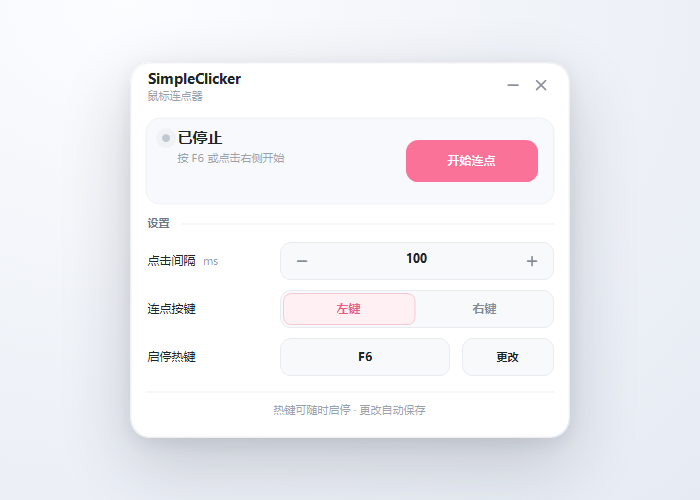

一个简单的鼠标连点器。界面使用与 TinyKeys 相同的自绘白色卡片风格。

## 可配置项

* 点击间隔

    单位 ms，可以直接输入，也可以点击两侧的 `−` / `+`

* 应用的键

    鼠标左键 or 右键

* 启停热键

    支持组合热键，设置后自动保存

界面：

## 使用指南

### 设置启停热键

点击“更改”，按下想要设置的组合键，再点击“确认”即可。

### 使用

* 点击“开始连点”或按下启停热键开始连点
* 点击“停止连点”或再次按下启停热键停止
* 间隔、按键和热键都会自动保存到同目录的 `config.ini`

原始功能代码来自 [通义千问](https://www.qianwen.com/)，界面、布局和状态显示经过重新设计。
